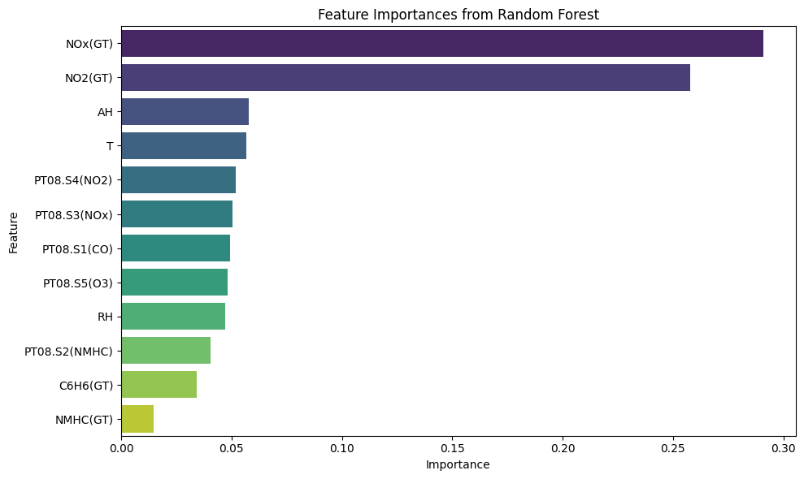
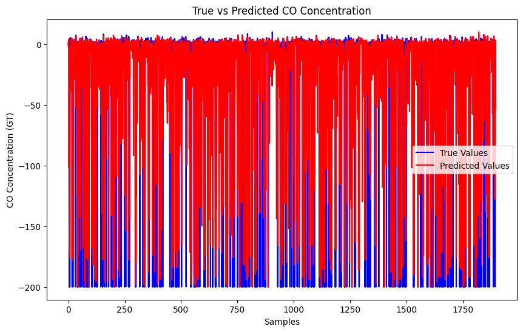
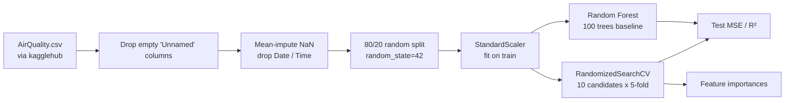

# Air Quality Prediction with Machine Learning

**Estimating hourly carbon-monoxide concentration from a low-cost multisensor device with a tuned Random Forest (UCI Air Quality data, hold-out R² 0.63).**

[](https://github.com/Akshatb848/Real-Time-Air-Quality-Prediction-Using-ML-Algorithms/actions/workflows/ci.yml)
[](LICENSE)
[](https://www.python.org/downloads/)


## Results at a glance

| Model | Test MSE | Test R² |
|---|---|---|
| Random Forest, `n_estimators=100` (baseline) | 2134.2465 | 0.6165 |
| Random Forest, tuned with `RandomizedSearchCV` | **2066.2100** | **0.6287** |

Both rows come from the saved outputs of `AQI_ML.ipynb` and use the same 20% random test split (`random_state=42`). Read them together with the [limitations](#limitations): the dataset's `-200` missing-value code was left in the data, and it dominates the error.

<p align="center">
  
  
</p>

*Left: tuned model feature importances. Right: true vs. predicted `CO(GT)` on the test split. The drops to −200 are the dataset's missing-value code, not real readings. This is the main thing to fix next. Both figures are taken unchanged from the notebook outputs.*

This is a single-notebook offline experiment built in Google Colab. Despite the repository name, it has no real-time data pipeline and no deployed model.

## Problem

Reference-grade gas analysers are expensive. Low-cost metal-oxide sensors are cheap but noisy. The question here is how well the true CO concentration from a reference analyser can be estimated from the other columns the device records in the same hour.

- **Target:** `CO(GT)`, the true hourly average CO concentration (mg/m³).
- **Features:** the other 12 numeric columns: `PT08.S1(CO)`, `NMHC(GT)`, `C6H6(GT)`, `PT08.S2(NMHC)`, `NOx(GT)`, `PT08.S3(NOx)`, `NO2(GT)`, `PT08.S4(NO2)`, `PT08.S5(O3)`, `T`, `RH`, `AH`.

## Data

| | |
|---|---|
| Dataset | Air Quality (De Vito et al.), hourly readings from a multisensor device in an Italian city, March 2004 to April 2005 |
| Original source | [UCI Machine Learning Repository, dataset 360](https://archive.ics.uci.edu/dataset/360/air+quality). UCI lists the licence as [CC BY 4.0](https://creativecommons.org/licenses/by/4.0/legalcode). |
| Copy used by the notebook | [Kaggle `fedesoriano/air-quality-data-set`](https://www.kaggle.com/datasets/fedesoriano/air-quality-data-set), file `AirQuality.csv` (`;`-separated, `,` decimals) |
| In this repo? | No. Cell 1 downloads it with `kagglehub`, which needs Kaggle API credentials. |

The missing-value report in the notebook shows 114 rows that are empty in every column. They come from trailing blank lines in the CSV.

## Approach



1. Download and load `AirQuality.csv` with pandas. Drop the empty `Unnamed` columns.
2. Fill `NaN` in numeric columns with the column mean, then drop `Date` and `Time`.
3. `train_test_split(test_size=0.2, random_state=42)`. The split is random, not time-ordered.
4. `StandardScaler` fitted on the training set.
5. Baseline: `RandomForestRegressor(n_estimators=100, random_state=42)`.
6. Tuning: `RandomizedSearchCV` over `n_estimators`, `max_depth`, `min_samples_split`, `min_samples_leaf`, `max_features` and `bootstrap`. It samples 10 candidates, uses 5-fold CV on the training set and scores by negative MSE. Best parameters:
   ```python
   {'n_estimators': 250, 'min_samples_split': 5, 'min_samples_leaf': 1,
    'max_features': 'sqrt', 'max_depth': 30, 'bootstrap': False}
   ```
7. Evaluate both models on the test split and plot the tuned model's feature importances.

`XGBRegressor` is imported but never trained.

## Reproduce

Tested with Python 3.11. CI installs `requirements.txt` on every push.

```bash
git clone https://github.com/Akshatb848/Real-Time-Air-Quality-Prediction-Using-ML-Algorithms.git
cd Real-Time-Air-Quality-Prediction-Using-ML-Algorithms
python3.11 -m venv .venv && source .venv/bin/activate   # Windows: .venv\Scripts\activate
pip install -r requirements.txt

# Kaggle credentials for kagglehub: ~/.kaggle/kaggle.json or KAGGLE_USERNAME / KAGGLE_KEY (never commit them)
jupyter notebook AQI_ML.ipynb
```

Run the cells top to bottom. Outside Kaggle or Colab, replace the hard-coded `/kaggle/input/air-quality-data-set/AirQuality.csv` in cells 4 and 5 with `os.path.join(dataset_path, "AirQuality.csv")`, where `dataset_path` is the path `kagglehub.dataset_download(...)` returns.

Smoke checks (no data or training needed). These are the same checks CI runs:

```bash
pip install pytest nbformat
pytest -q tests     # validates the notebook and checks that the README numbers match its saved outputs
```

## Repository structure

```
.
├── AQI_ML.ipynb              # download, preprocessing, Random Forest, tuning, evaluation (with saved outputs)
├── docs/images/              # figures extracted from the notebook outputs
├── tests/test_notebooks.py   # CI smoke checks: nbformat validity + README numbers match notebook outputs
├── requirements.txt
├── .github/workflows/ci.yml
└── LICENSE
```

## Limitations

- **The `-200` missing-value code is not handled.** The dataset records missing measurements as `-200`. The notebook only imputes `NaN`, so `-200` values stay in both features and target, as the right-hand plot shows. This is why the MSE is in the thousands when typical CO values are single-digit mg/m³. The reported MSE and R² mostly measure how well the model reproduces the missing-value code, not accuracy on real CO values.
- **The split is random on time-series data.** Neighbouring hours end up in both train and test, which tends to overstate performance compared with a chronological split.
- **Imputation happens before the split.** Column means use the full dataset, a small leak. The 114 fully empty rows should be dropped instead.
- **Reference-analyser readings are used as features.** `NMHC(GT)`, `C6H6(GT)`, `NOx(GT)` and `NO2(GT)` often share the target's missing hours. The top importances of `NOx(GT)` and `NO2(GT)` may partly reflect a shared missingness pattern rather than chemistry.
- **There is one split and no simple baseline.** There are no repeated splits and no comparison with a linear model or a mean predictor.
- **Notebook state.** Execution counts are out of order (the notebook was run non-linearly in Colab), and the data path is hard-coded.

## Next steps

1. Replace `-200` with `NaN`, drop rows where the target is missing, then impute features inside a scikit-learn `Pipeline` fitted on the training split only.
2. Use a chronological split (for example, train on 2004 and test on 2005) and `TimeSeriesSplit` for CV.
3. Add naive baselines (mean, previous hour) and a linear model. Report MAE in mg/m³.
4. Evaluate a sensor-only feature set (the `PT08.*` columns plus `T`, `RH`, `AH`), which is what a low-cost deployment would actually have.
5. Then try gradient boosting (`XGBRegressor` is already imported) and lag features.

## License

Code: [MIT](LICENSE) © 2026 Akshat Banga. The dataset is not redistributed here. Its own licence applies (CC BY 4.0 per UCI).

## Author

**Akshat Banga**, AI Generalist and AI transformation. [GitHub](https://github.com/Akshatb848) · [LinkedIn](https://www.linkedin.com/in/akshat-banga-6574aa170/)
